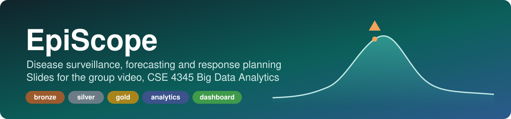

<p align="center"></p>

# EpiScope video slides

The slide deck for the EpiScope group video (CSE 4345 Big Data Analytics, CEP), by Group Sentinel BD: Nishadul Islam
Shezan, Tahsin Ahmed Rafi, Rimjhim Dey and Samira Sultana.

| | |
|---|---|
| **Slides** | https://shinzuu.github.io/episcope-video/ |
| **Video** | https://youtu.be/8HprXP6ck6w |
| **Project** | https://github.com/Shinzuu/episcope (code and report) |

## Using the deck

- `index.html`: right arrow, space, click or swipe for the next slide; left arrow to go back; `F` for full screen;
  `#12` in the URL opens slide 12. Each person presents their own lead area from the report's contribution matrix:
  Rafi analytics (detection, the forecast model, supplies, calendar); Samira platform and evaluation (problem and
  conflicts, de-identification, scaling, the detection and forecast evaluation, privacy, ethics and conclusion);
  Shezan data engineering (data, architecture, bronze, silver, gold, the live run, Spark choices); Rimjhim the
  dashboard, suppressed counts and the usability check.
- `config.json`: names and project roles (`role`, shown on slide 2). Edit only this file to change a name. Names
  appear on slide 2 only.
- `assets/scenes.js`: the 3D views on slides 1 and 20 (three.js). They run only while their slide is shown and fall
  back to a static SVG without WebGL or with reduced motion.
- `assets/base.css`: colour and font tokens, light and dark.

## Run locally

The deck works offline. `config.json` is loaded with `fetch`, so serve the folder instead of opening the file
directly (from `file://` the deck falls back to "Speaker 1" to "Speaker 4"):

```bash
python3 -m http.server 8000     # then open http://localhost:8000
```

## Update the numbers

```bash
python3 tools/extract_data.py <path to the EpiScope repo>   # charts: assets/data.js
```

Headline numbers in the slides are typed in from `docs/FINAL-NUMBERS.md` in the project repo.

## Credits

Dashboard screenshots are of the EpiScope dashboard on the final SF=1 build (EARS C2 4.0, CUSUM h 6.5); the
title curve and the rule chart use the SF=0.25 export of 21 Oct. 3D: three.js 0.180.0 (MIT, `assets/vendor/three-0.180.0/LICENSE`),
copied unchanged from cdnjs. Boundaries:
BBS / OCHA ROAP via HDX (CC BY-IGO). Font: Atkinson Hyperlegible Next (SIL OFL 1.1, `assets/fonts/OFL.txt`).
The data in the project is synthetic.

© 2026 EpiScope team. All rights reserved.
